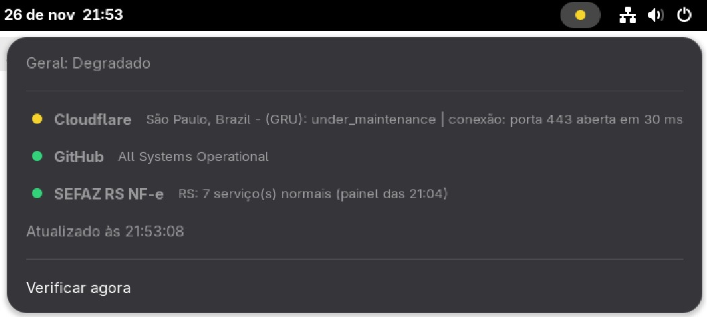
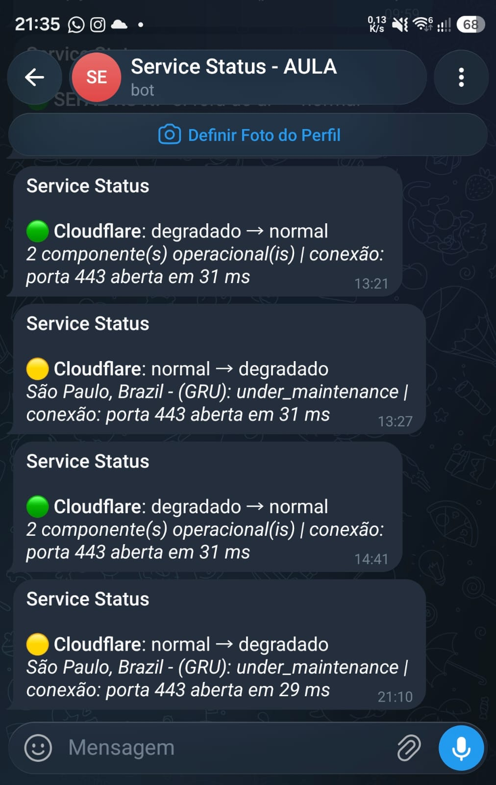

# Service Status

Indicador no painel do GNOME que mostra, com uma bolinha colorida, se serviços externos estão funcionando: SEFAZ (NF-e), Cloudflare, GitHub. Quando algum serviço muda de estado, um alerta chega no Telegram.

> Trabalho final da disciplina Automação e Programabilidade em Redes (UniSenac Pelotas).

## 1. Sobre o projeto e problema resolvido

Com muita frequência serviços externos de importância para a Internet param e o administrador acaba sabendo depois do usuário. Existem soluções como alertas através do Zabbix, mas quis integrar o monitoramento de alguns serviços com a topbar da interface gráfica GNOME, para garantir agilidade ao mesmo tempo que entrega uma solução elegante.

## 2. Arquitetura e fluxo de funcionamento

```
systemd timer (60 s)
        │
        ▼
coletor Python ──► Cloudflare, GitHub (statuspage)
        │      ──► Painel do Portal Nacional da NF-e   (scraping)
        │      ──► sonda TCP (conexão real a partir da rede do usuario)
        │
        ├── normaliza tudo em ok / degraded / down / unknown
        ├── grava ~/.cache/service-status/status.json
        └── se algum status mudou ──► Telegram Bot API (alerta)

extensão GNOME (GJS) ──lê a cada 5 s──► status.json ──► altera a cor da bolinha em caso de mudança.
```

**Gatilho:** timer do systemd (`service-status.timer`), ou o item "Verificar agora" no menu da extensão.

**Processamento:** cada check converte a resposta (JSON da status page, tabela HTML do painel da SEFAZ, conexão TCP) para um status comum. A cor geral é o pior status entre os serviços.

**Saída:** cor da bolinha no painel e mensagem no Telegram só quando há mudança de estado.

|Cor|Status|Significado|
|-|-|-|
|Verde|`ok`|Funcionando normalmente|
|Amarelo|`degraded`|Lento, manutenção ou falha parcial|
|Vermelho|`down`|Fora do ar|
|Cinza|`unknown`|Não foi possível verificar (status page inacessível, layout do painel não reconhecido, coletor parado)|

Um serviço pode combinar duas fontes: o que o fornecedor **declara** (status page) e o que a minha rede **mede** (sonda TCP, campo `probe`). A cor do serviço é a pior das duas.

A distinção entre vermelho e cinza é proposital: não conseguir consultar a status page não significa que o serviço caiu.

### Por que SEFAZ pelo painel, e não pelo web service

O web service da SEFAZ exige certificado digital A1 (TLS mútuo) até para consultar o status. Para funcionar sem certificado, o check `sefaz_portal` lê o painel público "Disponibilidade" do Portal Nacional da NF-e, que a própria SEFAZ atualiza a cada cerca de 5 minutos.

Como o portal não oferece API, o check faz scraping da tabela HTML: localiza a linha do autorizador configurado (ex.: `RS`), lê a cor de cada bolinha pelo nome da imagem e aplica a regra do pior status. O parser procura as colunas pelo texto do cabeçalho, e não pela posição, e qualquer estrutura não reconhecida resulta em cinza, nunca em verde. Se o próprio painel estiver sem atualização há mais de 30 minutos, o resultado também é cinza.

## 3. Tecnologias e APIs utilizadas

* **Python 3:** `requests` (HTTP com retry via `urllib3.Retry`), `BeautifulSoup` (parsing do HTML do portal), `PyYAML`, `python-dotenv`, `socket`, `concurrent.futures`
* **GNOME Shell extension (GJS, módulos ESM):** `St`, `Gio`, `GLib`, `PanelMenu`, `PopupMenu`
* **systemd user units:** service `oneshot` + timer
* **APIs e protocolos:** Atlassian Statuspage API v2 (JSON), painel de disponibilidade do Portal Nacional da NF-e (HTML), Telegram Bot API (HTTPS + token), sonda TCP
* **Formatos estruturados:** YAML (configuração), JSON (status pages, estado, Telegram), HTML (painel da SEFAZ)

## 4. Pré-requisitos e como executar

**Requisitos:** GNOME Shell 45 a 51, Python 3.10+, systemd.

1. Clone o repositório:

   ```bash
   git clone https://github.com/SEU_USUARIO/service-status.git
   cd service-status
   ```

2. Rode o instalador:

   ```bash
   bash install.sh
   ```

   Ele cria um virtualenv em `~/.local/share/service-status`, copia `config.example.yaml` e `.env.example` para `~/.config/service-status/` (o `.env` com permissão 600), ativa o timer e instala a extensão.

3. Configure o Telegram em `~/.config/service-status/.env`:

   * Crie um bot no [@BotFather](https://t.me/BotFather) e copie o token para `TELEGRAM_BOT_TOKEN`.
   * Mande uma mensagem ao bot e abra `https://api.telegram.org/bot<TOKEN>/getUpdates`; o valor de `chat.id` vai em `TELEGRAM_CHAT_ID`.
4. Ajuste os serviços em `~/.config/service-status/config.yaml`.
5. No Wayland, faça logout e login e depois ative: `gnome-extensions enable service-status@henrique`.

**Comandos úteis:**

```bash
systemctl --user start service-status.service   # roda o coletor agora
journalctl --user -u service-status -f          # acompanha os logs
cat ~/.cache/service-status/status.json         # estado atual
bash uninstall.sh                               # remove tudo (mantém a configuração)
```

## 5. Demonstração

**Indicador no painel com o menu aberto:**



**Alerta recebido no Telegram:**




## 6. Melhorias futuras (roadmap)

* Tela de preferências na extensão para o usuário escolher o estado (UF) monitorado na SEFAZ
* Deixar a janela do menu aberta ate remover o mouse.
* Adicionar mais serviços.

